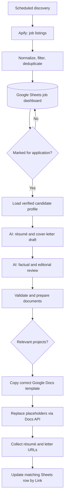

# AI-Assisted Job Search & Application Automation

**Self-hosted job discovery, tracking, and document preparation with n8n, Docker, JavaScript, OpenAI, and Google Workspace.**

This project connects job discovery with a human-reviewed application workflow. It gathers job listings, tracks them in Google Sheets, and—only when a job is selected—generates and reviews a tailored résumé and cover letter. The final documents are created from styled Google Docs templates, with links written back to the matching job row.

> **Scope:** Application **preparation**, not automatic job submission. A person reviews the jobs and documents before applying.

## Why I built it

I wanted a way to reduce repetitive work during a job search without giving up control over which positions to pursue or what information appears in my applications. Rather than rely on a single AI prompt, I built a multi-stage process with job deduplication, a verified career profile, a second AI review, structured document generation, and a tracking dashboard.

## Key capabilities

- **Scheduled discovery:** Find recent LinkedIn job postings through an Apify actor and process the results in n8n.
- **Centralized job dashboard:** Store and deduplicate listings in Google Sheets using a normalized job URL (`Link`) as the record identifier.
- **Human-in-the-loop selection:** Generate application materials only for jobs manually flagged in the sheet (`Make Cover`).
- **Two-stage AI workflow:** Draft job-specific documents, then review against a verified candidate profile to correct unsupported claims, wording, and omissions.
- **Structured processing:** Transform reviewed JSON using n8n Code nodes and validate required content before creating files.
- **Styled documents:** Copy the appropriate Google Docs template, then populate it using Google Docs `documents.batchUpdate` / `replaceAllText`.
- **Optional project sections:** Use different résumé templates depending on whether relevant projects are included.
- **Traceability:** Save résumé and cover-letter Google Docs URLs back to the original row by `Link` rather than storing long text in the sheet.
- **Self-hosting:** Run n8n in Docker on an Unraid server.

## Technology

| Component | Role |
| --- | --- |
| Unraid + Docker | Self-hosted workflow runtime |
| n8n | Scheduling, orchestration, transformations, error handling |
| Apify | LinkedIn job discovery |
| JavaScript (n8n Code nodes) | Parsing, filtering, field mapping, validation, grouping |
| OpenAI API | Draft and review structured application content |
| Google Sheets API | Job tracking, selection, and document links |
| Google Drive API | Copy document templates and organize files |
| Google Docs API | Fill styled templates with job-specific content |
| OAuth 2.0 | Authorized access to Google Workspace APIs |

## Architecture



The discovery and document-preparation processes are separate n8n workflows. See [Architecture](docs/architecture.md) for the node-level design.

## Job dashboard fields

The core tracking fields are:

| Field | Purpose |
| --- | --- |
| `Link` | Canonical LinkedIn job URL; unique matching key |
| `Make Cover` | Human-controlled flag to prepare application materials |
| `Resume` | Link to the generated Google Docs résumé |
| `Cover Letter` | Link to the generated Google Docs cover letter |

Additional job metadata, relevance scores, and statuses can be tracked as needed.

## Repository structure

```text
.
├── README.md
├── docs/
│   ├── architecture.md
│   ├── setup.md
│   ├── security.md
│   ├── troubleshooting.md
│   └── screenshots.md
├── examples/
│   └── sample-job.json
├── scripts/
│   └── audit_n8n_export.py
└── workflows/
    └── README.md
```

> **Workflow export status:** This initial documentation package does **not** include the live n8n workflow exports. Those must be exported from n8n and reviewed for sensitive information before they are committed. See [workflows/README.md](workflows/README.md).

## Getting started

1. Run n8n in your own environment (for example, Docker).
2. Configure Apify, OpenAI, and Google OAuth credentials in n8n. Never store those credentials in this repository.
3. Create a Google Sheets dashboard with `Link`, `Make Cover`, `Resume`, and `Cover Letter` columns.
4. Set up **three Google Docs templates**: résumé with projects, résumé without projects, and cover letter.
5. Prepare a private, verified candidate profile. Do **not** commit personal career records into a public example repository.
6. Import your sanitized workflow exports once available and reconnect credentials and resource IDs.
7. Test with one fictional or otherwise safe job row; verify the resulting Google Docs before enabling unattended schedules.

Full configuration instructions: [docs/setup.md](docs/setup.md).

## Design decisions and lessons learned

- **Use stable IDs:** A canonical LinkedIn URL is more reliable than assuming item order always stays the same.
- **Preserve item metadata:** n8n Code nodes must carry `Link`, `document_type`, and item relationships through document creation.
- **Validate AI output:** Structured output alone does not guarantee that required experience was preserved; the workflow checks for missing roles and bullets.
- **Separate content from layout:** The LLM writes text; Google Docs templates control formatting.
- **Handle optional sections deliberately:** Two résumé templates prevent empty section headings or borders when no project is selected.
- **Review generated files:** Successful API responses do not guarantee a well-formatted or factually complete document.

See [troubleshooting](docs/troubleshooting.md) for specific problems encountered during development.

## Security and privacy

The live system involves private job data, OAuth integrations, and personal application materials. **This repository is intended to contain architecture and sanitized examples only.** Do not publish raw n8n exports, API keys, tokens, Google document IDs, webhook endpoints, personal contact information, or real application documents. See [Security](docs/security.md) and the local export audit tool.

## Future improvements

- Version-controlled, sanitized workflow exports and example test fixtures
- Stronger schema validation for AI responses
- PDF exports and document quality checks
- More robust per-job retry and idempotency handling
- Automatic document versioning and safe duplicate detection
- Dashboards for workflow failures and processing outcomes

## Project status

Actively developed as a personal automation and systems-integration portfolio project. Implemented capabilities above describe the working local prototype; setup varies by environment.

## License

No license has been selected yet. Please contact the repository owner before reuse or redistribution.