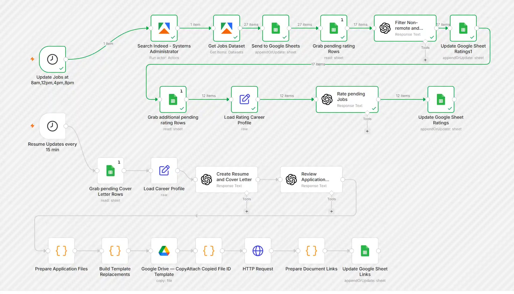
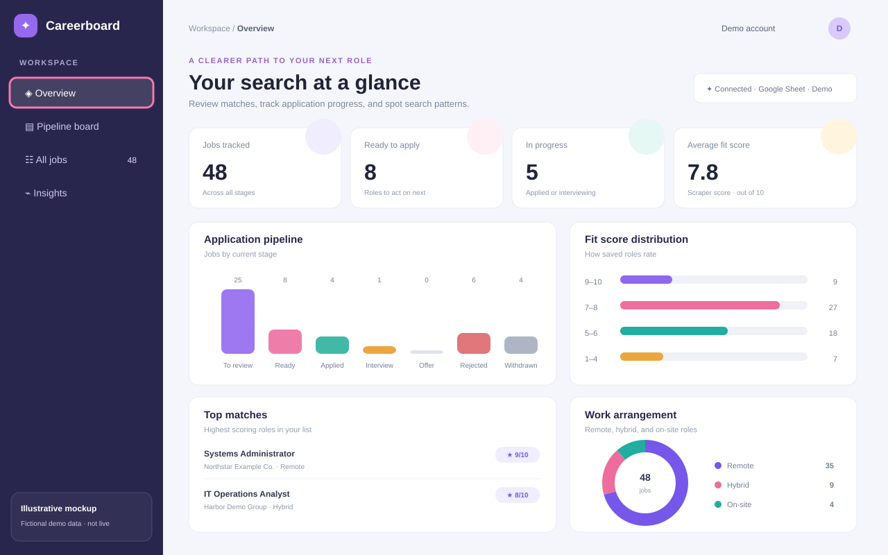
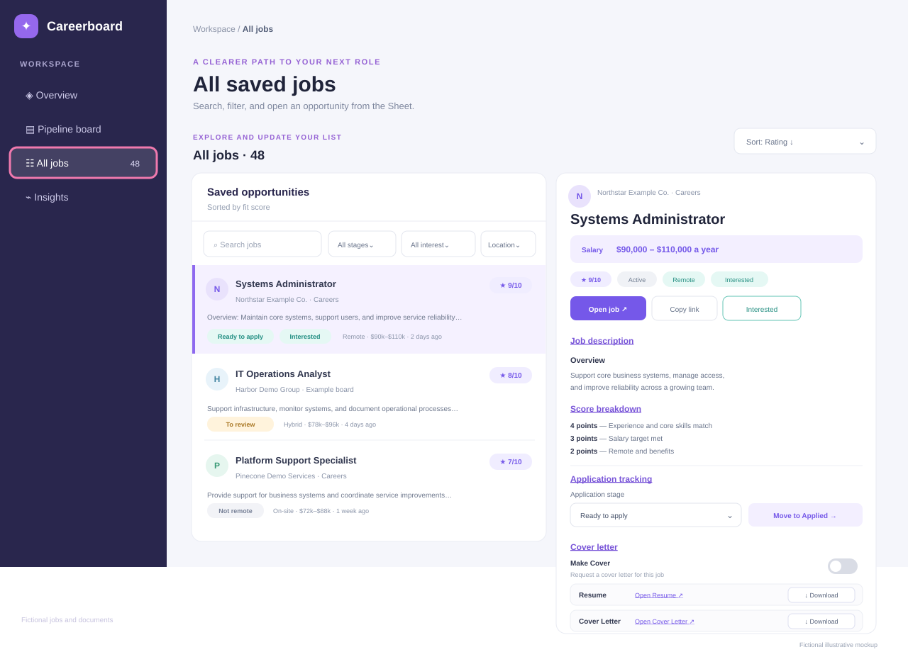

# AI-Assisted Job Search & Application Automation

**A self-hosted n8n project that discovers and scores job listings, then helps prepare tailored applications with two-stage AI review and styled Google Docs templates.**

Built with **n8n, Docker / Unraid, Apify, JavaScript, OpenAI, and Google Sheets / Drive / Docs APIs**.

> **Human in the loop:** Jobs are selected manually for application preparation. This project does not automatically submit job applications.

## Updated n8n workflow



*Actual n8n editor screenshot from October 23, 2026. The upper branch finds, filters, and scores jobs; the lower branch prepares and reviews résumé and cover-letter documents for manually selected applications. [Older editor screenshot](docs/images/n8n-workflow-screenshot.webp) · [Simplified architecture diagram](docs/images/workflow-schematic.svg).*

## Where it started

This project began with **Jono Catliff's** tutorial, [**Automate Your Job Search Using AI (Indeed, LinkedIn, ZipRecruiter)**](https://www.youtube.com/watch?v=LIzZRgfW4ok&t=579s).

I started by following the job-search automation concept, then kept finding things I wanted to improve. It snowballed into a larger self-hosted project with a Google Sheets-backed dashboard, job-fit scoring, human-selected applications, a verified career profile, a separate AI review step, and styled résumé and cover-letter generation through the Google Docs API.

Credit to Jono for the original inspiration. The additional workflow logic, dashboard, review steps, and document system are my own extensions.

[](https://www.youtube.com/watch?v=LIzZRgfW4ok&t=579s)

*Click the thumbnail to watch the original tutorial on YouTube.*

## What it does

This is **one n8n workflow with two branches**, sharing a Google Sheets database and dashboard:

1. **Job discovery, eligibility and scoring:** A scheduled Apify/Indeed search gathers listings and upserts them by their `Link` into Sheets. An initial AI screen examines **the full job description**, not just the provider's remote flag, and sets `Rating=0` and a rejection reason for clearly excluded locations or mandatory government/military security clearances. The workflow **re-reads remaining unrated jobs**, loads a separate verified career profile, and assigns a **1–100 score** weighted by career fit (50 points), salary (25), and benefits (25). Scores and explanations update their existing Sheets rows.
2. **Application preparation after manual selection:** A job marked `Make Cover` is read on a 15-minute schedule. A separate verified career profile is used to draft a tailored résumé and cover letter, perform a second AI review, validate the JSON, fill Google Docs templates and write the document links back to the same job. **No job application is submitted automatically.**

For safety, the **public sanitized example disables both triggers**. The private working export can have a different enabled state.

## Technical highlights

- Multi-service orchestration in self-hosted **n8n** running in Docker on Unraid.
- **Apify** actor + dataset consumption, with results stored in **Google Sheets** using the `Link` field for row matching.
- **Two-stage AI filtering and scoring**: reject clearly ineligible jobs first, then score eligible listings from 1 to 100 using separate career-profile context.
- **Two-step application drafting/review** for manually selected opportunities.
- **JavaScript Code nodes** for validating model-generated JSON, preserving item relationships, splitting résumé and cover-letter records, and grouping final document URLs.
- **Google Drive** template copying and **Google Docs** `documents.batchUpdate` / `replaceAllText` for consistent formatting.
- Conditional résumé templates for jobs with or without a relevant personal projects section.
- OAuth-based Google API integration, structured-data processing, debugging of item links, and handling API quota limits.
- Manual selection and final document review before an application is sent to an employer.

## Dashboard screenshots

The dashboard is a Google Apps Script web app connected to a private Google Sheet. It supports job review, application tracking, interest decisions, and links to generated documents. See the [dashboard guide](docs/dashboard.md) for how it works.

**These are sanitized illustrations with fictional job data, not screenshots of the authenticated live dashboard or Sheet.**

### Dashboard overview



### All Jobs and job details



## Workflow architecture

The [updated 23-node architecture](docs/architecture.md) documents the eligibility screen, re-query of pending jobs, separate rating career-profile loader and 15-minute application-check schedule. The [sanitized workflow JSON](workflows/indeed-job-discovery-and-application-generator.sanitized.json) reflects that node graph.

## Project contents

```text
.
├── README.md
├── LICENSE
├── prompts/
│   ├── README.md
│   └── eight reusable prompt message files
├── docs/
│   ├── architecture.md
│   ├── dashboard.md
│   ├── setup.md
│   ├── security.md
│   ├── troubleshooting.md
│   └── images/
│       ├── n8n-workflow-screenshot-oct-2026.webp
│       ├── workflow-schematic.svg (supplemental)
│       ├── n8n-workflow-screenshot.webp (earlier workflow)
│       ├── dashboard-overview.svg
│       └── dashboard-all-jobs.svg
├── apps-script/
│   ├── Code.gs
│   ├── Index.html
│   └── README.md
├── workflows/
│   ├── indeed-job-discovery-and-application-generator.sanitized.json
│   └── README.md
├── scripts/audit_n8n_export.py
├── examples/sample-job.json
└── .gitignore
```

The [workflow export](workflows/indeed-job-discovery-and-application-generator.sanitized.json) is a **sanitized demonstration** of the actual node graph, **not a live configuration**. It contains fictional candidate data and placeholder IDs, and deliberately excludes service credentials and execution/pinned data. You must provide your own authorized service accounts, Sheets and Docs resources, and verified candidate details.

## Dashboard

| Field | Purpose |
| --- | --- |
| `Link` | Unique job URL, used as the row-matching key |
| `Rating` / `Score breakdown` | Rejection value 0, or detailed 1–100 job-fit score and explanation |
| `Not Interested` / `Not Interested Reason` | Screening rejection flag and reason |
| `Make Cover` | Human selection flag |
| `Resume` | Link to generated styled Google Doc |
| `Cover Letter` | Link to generated styled Google Doc |

Other tracked fields include job title, description, company, date, salary, work arrangement, and job type.

## Setup

Start with [docs/setup.md](docs/setup.md), then consult the [security checklist](docs/security.md). The recommended test is one fictional job with both documents verified before making the workflow accessible to live data.

## Decisions and trade-offs

- **Prevent silent omissions:** Validate AI output rather than assume the reviewer preserved all résumé positions and bullets.
- **Keep a stable job key:** Use the `Link` column to update the correct existing row, not the Sheet row number.
- **Separate content from presentation:** AI produces structured text; Google Docs templates preserve visual formatting.
- **Support optional projects:** Use two résumé templates to avoid blank sections and leftover horizontal rules.
- **Control AI behavior:** Career information must come from verified profile data, not from unsupported job-posting claims.
- **Avoid autonomous applications:** Final application submission is outside this automation.

## Current limitations and next steps

- Resume page length is not yet automatically validated; PDF export, quality checks, and document versioning are potential additions.


This is a **personal automation / systems-integration portfolio project**, not an autonomous application service or a production-ready product.

## License

This project is licensed under the **MIT License** — see the [LICENSE](LICENSE) file for details.

Copyright © 2026 Matt Clausen.

You are free to use, modify, distribute, and build upon the original code, workflows, prompts, and documentation in this repository, subject to the terms of the MIT License.

### Third-Party Software and Services

This project integrates with third-party platforms, including n8n, OpenAI, Apify, and Google services.

Each third-party platform retains its own licensing terms, usage restrictions, and API requirements.

In particular, n8n is distributed under the Sustainable Use License, which applies independently of this project's MIT License.

This project is independently developed and is not affiliated with or endorsed by these third-party providers.
