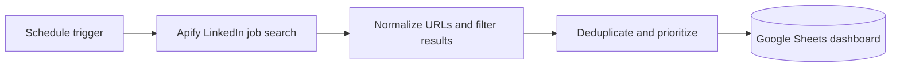
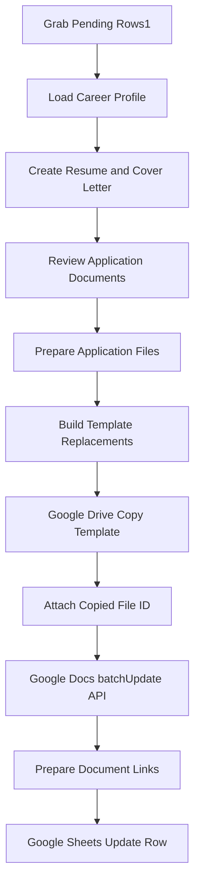

# Architecture and data flow

The system has two independent n8n workflows. Job discovery runs on a schedule; application preparation only runs after a job has been selected. It **does not automatically submit applications**.

## Discovery

The LinkedIn `Link` column is the stable lookup key used for new jobs and later document updates. Tracking parameters are stripped from URLs.

## Application preparation

The generation and review stages use a verified candidate profile and structured JSON. One selected job creates two prepared items: `document_type=resume` and `document_type=cover_letter`. Both retain the job `Link`. The document-builder validates relevant work experience, prepares placeholder replacement requests, and sets `hasProjects` to select a résumé template with or without the optional projects section.

Google Drive copies a styled template and returns a new file ID. Google Docs `documents.batchUpdate` populates that copy using `replaceAllText`. After **both** updates succeed, the workflow groups document URLs by `Link` and updates the existing row's `Resume` and `Cover Letter` columns.

## Important design decisions

- **Human approval:** discovered jobs do not automatically generate or submit applications.
- **Stable identity:** use a normalized LinkedIn URL rather than row numbers.
- **Fact checks:** AI output is treated as untrusted and checked against verified career data.
- **Separation of concerns:** templates handle design, the AI handles text.
- **Optional sections:** different templates prevent empty headings or borders.
- **Error checks:** do not mark a row complete until both document links exist.
- **Limits:** some current n8n stages depend on item-order correspondence; keyed joins and idempotent retries are future improvements.

The Mermaid diagrams describe the implementation; exact node names and wiring should be verified against a safely sanitized export before attempting to import or reproduce the workflow.
