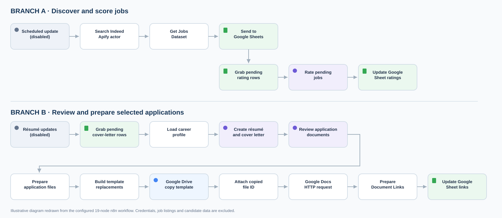
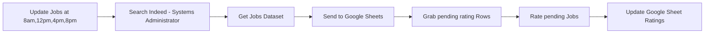
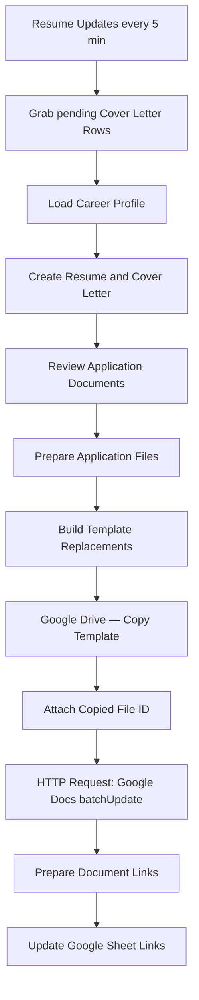

# Architecture and node reference

This project uses **one n8n workflow with two branches** and **19 nodes**, not two separate imported workflows. The two branches share a Google Sheets dashboard but have distinct triggers and processing paths.

## Branch A — Discover and score jobs

The Apify actor fetches **Indeed Systems Administrator** listings. The Sheets upsert uses `Link` as the matching column. Unrated jobs are passed to the AI scorer, then `Rating` and `Score breakdown` are updated by that link. The 8 a.m., noon, 4 p.m., and 8 p.m. cron trigger is **disabled in the shared export**; exact clock behavior depends on the n8n workflow time zone.

**Known limitation:** The present scoring prompt assumes that listings have benefits and full-time status, even if data differs. Scores are illustrative until those assumptions are corrected. The stored job URL is used directly; normalization and tracking-parameter removal are not guaranteed by this export.

## Branch B — Prepare applications selected in Sheets

A user flags a row using `Make Cover` (human approval). A verified career profile is loaded into the private workflow, and one AI stage writes JSON containing a résumé and cover letter. Another AI stage reviews factual support and completeness.

The code nodes validate required positions and achievements, then prepare **two document items per selected job**. Both carry `Link` and `document_type`. A `hasProjects` flag selects one of two résumé templates to prevent empty optional sections.

The Google Drive Copy node creates a new native Google Docs file, the Docs API `documents.batchUpdate` replaces placeholder text, and a final Code node groups the résumé and cover-letter links by `Link`. `Update Google Sheet Links` writes the URLs to the matching row and records completion. The five-minute schedule trigger is **disabled in the shared export**.

## Implementation trade-offs

- **Human-in-the-loop:** No direct job applications are submitted to employers.
- **Accuracy checks:** Output is reviewed against a verified profile; the public copy substitutes a fictional profile.
- **Document generation:** Google Docs templates handle style; the AI produces structured text.
- **Identifier:** `Link` is used as a matching key, but not formally canonicalized in this export.
- **Data lineage:** Some Code nodes use n8n `itemMatching()`; document result pairing also relies on item order, verified by count. Large-batch retries deserve further testing.
- **Privacy:** The published workflow is a sanitized reference. It intentionally cannot run until the owner configures real credentials and private resource IDs.
